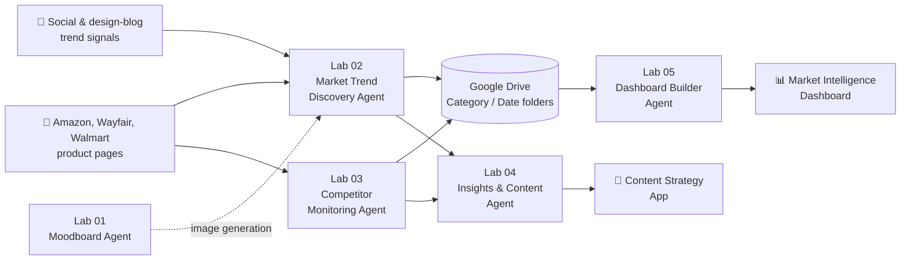

# 🤖 Agentic Workflow Hub
### The build behind Wayfair Agentic BI: five n8n labs, from "Hello World" to a multi-agent market-intelligence dashboard

**n8n · Google Gemini · Mistral AI · Hugging Face FLUX · Cheerio · Google Drive API** · Mar 2026 – May 2026

---

## Contents
[TL;DR](#tldr) · [How the Agents Fit Together](#how-the-agents-fit-together) · [The Labs](#the-labs) · [Key Design Decisions](#key-design-decisions) · [What I Learned](#what-i-learned) · [Repo Guide](#repo-guide) · [My Role](#my-role)

---

## TL;DR

| | |
|---|---|
| **Problem** | Retail category managers piece together trends and competitor moves from scattered sources, so insight arrives late and in separate reports. |
| **What I built** | A chain of n8n agents that scrapes product and trend data, analyzes it with LLMs, writes reports, and merges everything into one executive dashboard. |
| **Agents** | Moodboard Generator · Market Trend Discovery · Competitor Monitoring · Insights & Content · Dashboard Builder |
| **Output** | Trend reports, a competitor analysis, a 3-tab content strategy app, and a unified Market Intelligence Dashboard, generated in under a minute |
| **Companion repo** | The product side — three PRDs, the prototype, and the case study — lives in **[Wayfair-Agentic-BI](https://github.com/LashawnFofung/Wayfair-Agentic-BI)** |

> *Independent learning project using Wayfair as the example business. Not affiliated with or endorsed by Wayfair.*

---

## How the Agents Fit Together

Each agent started as a standalone lab. By Lab 05, the trend and competitor agents save their reports to dated Google Drive folders, and the Dashboard Builder pulls the latest of each into one view.

---

## The Labs

### 🧪 Lab 01 — Moodboard Generator Agent
**Goal:** Turn a simple décor idea ("Scandinavian round jute rug") into a moodboard image.

**How it works:** Chat trigger → Gemini agent with a system prompt acting as an image-prompt engineer → JavaScript node that cleans the output for the API → Hugging Face **FLUX.1-schnell** generates the image.
**Also in this lab:** environment check ("Hello World"), conditional branching with If nodes, and a standalone prompt generator.

📄 [Lab write-up](Labs/Lab%2001:%20Moodboard%20Generator%20AI%20Agent.md) · 🎥 [Logic walkthrough](https://youtu.be/NTS5aiap6MQ) · [Live run](https://youtu.be/d6nro9oYpK4) · 🧩 [Workflow JSON](N8N%20Workflow/Moodboard%20Agent%20N8N%20Workflow.json)

---

### 🧪 Lab 02 — Market Trend Discovery Agent
**Goal:** Spot emerging product micro-segments before competitors do.

**How it works (7 stages):** input and routing → Amazon product extraction and social/blog trend signals in parallel → **Mistral** normalizes and classifies products → **Gemini** synthesizes insights → FLUX generates trend imagery → merge → HTML trend report.

📄 [Lab write-up](Labs/Lab%2002%20Discovery%20AI%20Agent.md) · 📊 [Sample output: Shag Rug Trend Report](Lab%20Artifacts/Lab%202/Shag%20Rug%20Trend%20Report.pdf) · 🎥 [Stage walkthrough](https://youtu.be/c-Kibixr2IA) · [Node detail](https://youtu.be/JWo-M8jyzRA) · 🧩 [Workflow JSON](N8N%20Workflow/Market%20Trend%20Discovery%20Agent.json)

---

### 🧪 Lab 03 — Competitor Monitoring Agent
**Goal:** Benchmark pricing and find "whitespace" gaps across retailers.

**How it works (6 stages):** parse target URLs and categories → scrape Wayfair as the baseline → scrape Amazon (product and category paths in parallel) → scrape Walmart → **Gemini 2.0 + Mistral Large** analyze pricing and gaps → assemble a styled HTML report saved to Google Drive.

📄 [Lab write-up](Labs/Lab%2003%20Competitor%20Monitoring%20AI%20Agent.md) · 📊 [Sample output: Area Rugs Competitor Report](Lab%20Artifacts/Lab%203/Competitor%20Analysis%20Report%20-%20Area%20Rugs.pdf) · 🎥 [Walkthrough](https://youtu.be/gi0bSrUmX9E) · 🧩 [Workflow JSON](N8N%20Workflow/Competitor%20Monitoring%20AI%20Agent.json)

---

### 🧪 Lab 04 — Insights & Content Agent
**Goal:** Turn the trend and competitor reports into brand-aligned marketing assets.

**Starting point:** an inherited n8n content workflow, which I reverse-engineered and extended.

**What I added:**
- **Personalization:** Style Persona dropdown (e.g., Minimalist, Maximalist) and custom Vibe Keywords on the input form.
- **Output guardrails:** a strict JSON schema plus an "anti-AI-ism" filter that strips generic corporate filler.
- **Moodboard assets:** a required JSON block with color hex codes, textures, and layout ideas.
- **App conversion:** turned a static HTML report into a 3-tab app (Strategy · Design · Creative) with To Do / Drafting / Ready status tracking and click-to-copy captions.

📄 [Lab write-up](Labs/Lab%2004%20AI%20Insight%20and%20Content%20Agent.md) · 📊 [Sample output: Area Rug Content Strategy](Lab%20Artifacts/Lab%204/Wayfair_Area_Rug_Content_Strategy.html) · 🧩 [Workflow JSON](N8N%20Workflow/Content%20Strategy%20AI%20Agent.json)

---

### 🧪 Lab 05 — Dashboard Builder Agent (Capstone)
**Goal:** Replace scattered reports with one decision-ready executive briefing.

**How it works:**
1. Upgraded the Lab 02 and Lab 03 agents to save their reports automatically to Google Drive, in `Wayfair Reports / [Category] / [YYYY-MM-DD]` folders created on the fly.
2. The Dashboard Builder finds the newest date folder and downloads the latest trend report, competitor report, and dashboard template together.
3. A **Cheerio** parser turns each HTML report into structured JSON: micro-segments, color swatches, market size, CAGR, and risks from Lab 02; product counts, price gaps, stock gaps, and suppliers from Lab 03.
4. The data is injected into a responsive dashboard with Overview, Market Trends, and Competitor Insights tabs. Color names render as real swatches, and missing fields show a clean fallback instead of breaking the layout.

📄 [Lab write-up](Labs/Lab%2005%20Final%20AI%20Agent.md) · 📊 [Sample output: Area Rug Dashboard](Lab%20Artifacts/Lab%205/Area_Rug_Dashboard_2026-05-08.html) · 🧩 Final workflows: [Dashboard Builder](N8N%20Workflow/Final%20Deliverables/Dashboard%20Builder%20Agent.json) · [Trend Discovery v2](N8N%20Workflow/Final%20Deliverables/Market%20Trend%20Discovery%20v2.json) · [Competitor Monitoring v2](N8N%20Workflow/Final%20Deliverables/Competitor%20Monitoring%20AI%20Agent%20v2.json)

---

## Key Design Decisions

| Decision | Why | Trade-off |
|---|---|---|
| **Use different LLMs for different jobs** | Mistral handles cleanup and classification; Gemini handles synthesis and writing | Two providers to manage and prompt |
| **Force JSON output with a strict schema** | Downstream nodes break on free-form text; a schema keeps the pipeline stable | Less creative freedom, so I added a separate tone filter |
| **Clean LLM output in code before API calls** | Markdown and line breaks from one model broke the image API | An extra node to maintain |
| **Save each agent's output to dated Drive folders** | Turns one-off reports into a history the dashboard can always find | Depends on consistent folder naming |
| **Parse HTML reports with Cheerio** | Lets one agent's report become structured input for the next, without rebuilding upstream agents | Parser must change if report layouts change |
| **Fallbacks for missing fields** | One failed scrape shouldn't break the whole dashboard | Gaps can be less visible, so the empty state is labeled |

---

## What I Learned

- **The value is in the pipeline, not one report.** Connected agents that rerun on their own beat a single impressive output.
- **Agents need contracts.** Strict JSON schemas between steps mattered more than clever prompts.
- **Scraping is the fragile part.** Retailer pages change and push back on automated traffic, so a real product would use official data feeds or licensed APIs instead.
- **PM + builder is a real advantage.** Building the agents myself made the PRDs in the companion repo more realistic about scope, failure modes, and data needs.

---

## Repo Guide

| Folder | What's inside |
|---|---|
| [`Labs/`](Labs) | Write-ups for each of the five labs |
| [`N8N Workflow/`](N8N%20Workflow) | Importable n8n workflow JSON files; final versions are in `Final Deliverables/` |
| [`Lab Artifacts/`](Lab%20Artifacts) | Screenshots, generated images, and sample reports from each lab |

**To try a workflow:** in n8n, choose *Import from File*, select a JSON file, then add your own credentials (Gemini, Mistral, Hugging Face, Google Drive). No API keys are stored in this repo.

---

## My Role

Solo project. I designed, built, and documented all five agents, extended an inherited content workflow (Lab 04), and wrote the matching PRDs and case study in [Wayfair-Agentic-BI](https://github.com/LashawnFofung/Wayfair-Agentic-BI).

---

**Lashawn Fofung** · Technical Product Manager · [LinkedIn](https://www.linkedin.com/in/lashawnfofung/) · [AI Portfolio](https://github.com/LashawnFofung/AI-Portfolio) · [MBA Portfolio](https://github.com/LashawnFofung/MBA-IT-Management-Portfolio)

